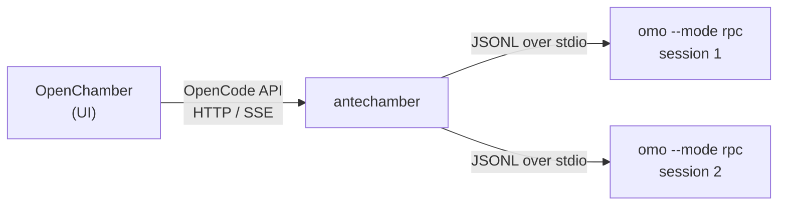

# antechamber

**Run the [OmO](https://github.com/code-yeongyu/oh-my-openagent) coding agent inside
[OpenChamber](https://github.com/openchamber/openchamber).** antechamber stands in for OpenCode as OpenChamber's
server, so you keep OpenChamber's UI (sessions, tool cards, approvals, diffs) while every session runs on OmO.

[](https://github.com/eliottness/antechamber/actions/workflows/ci.yml)
[](https://www.npmjs.com/package/antechamber)
[](./LICENSE)

[Quick start](#quick-start) · [Features](#features) · [How it works](#how-it-works) ·
[Configuration](#configuration) · [Docs](#documentation)

## Quick start

You need **OpenChamber 2.3.2+** (web or desktop) and **[Bun](https://bun.sh) 1.4+** on the machine OpenChamber runs on.

1. In OpenChamber, open **Settings → Extensions → Add → URL** and enter:

   ```text
   https://github.com/eliottness/antechamber
   ```

2. Approve the two permissions it asks for: **sessions** and a **local service** (it runs `bun`).
3. Open the **OmO** rail panel's settings (the sliders icon). When the **Runtime** block says antechamber is
   installed, click **Use as OpenCode CLI**, then **Reload OpenCode**.

That's it: new sessions run on OmO. The first start downloads the antechamber release matching the extension's version,
and the OmO it pins, into `~/.antechamber/runtime/<version>`. To update both, update the extension in **Settings →
Extensions** when OpenChamber offers it.

**Other ways to install.** Prefer the CLI? Run the two commands below, then restart OpenChamber. For an isolated
profile, systemd, or a source checkout, see [docs/installation.md](docs/installation.md).

```bash
npm i -g antechamber
antechamber setup --auto-update
```

## Features

| Feature | What you get |
|---|---|
| **Native OpenChamber sessions** | Create, rename, archive, delete; streamed text and reasoning; abort; model and thinking-level pickers. |
| **Tool and sub-agent cards** | bash, edit, write and the rest render as native tool parts; OmO sub-agents get task cards. |
| **Approvals and questions** | OmO's permission prompts and structured questions show up as OpenChamber's own dialogs. |
| **Fork, revert, unrevert** | Backed by the agent's session tree. Revert rewinds the conversation only and never touches your files. |
| **OmO Graph** | A rail panel (and full-screen page) drawing the open session's sub-agents as a live, clickable graph. |
| **OmO Work** | A Work Status section with the session's todo phases, goal timer and other wake sources. |
| **Readable tool headers** | Eval cells read `JS Eval` / `Python Eval` plus their summary; sub-agent cards show agent and description. |
| **Long-running friendly** | Sessions survive restarts; idle sessions are reaped and live agent processes are capped. |

## How it works

OpenChamber only speaks the OpenCode HTTP/SSE API. OmO is a headless agent with its own RPC protocol (JSONL over
stdio). antechamber implements the part of the OpenCode API that OpenChamber uses and translates each call into an OmO
RPC session, one agent process per session. No fork of OpenChamber or OmO is involved.



Each antechamber release depends on one exact OmO (`omo-ai`) version, so the pair you run is the pair that was tested
together. Design notes: [docs/architecture.md](docs/architecture.md).

### Compatibility

| Component | Supported |
|---|---|
| OpenChamber | 2.3.2 and newer (OpenCode v2 `/api/*`); other versions are not tested |
| Agent | [OmO](https://github.com/code-yeongyu/oh-my-openagent) (default). Plain [pi](https://github.com/badlogic/pi-mono) works best-effort with `ANTECHAMBER_PI_BINARY=pi`, without the OmO-specific features |
| OS | Linux (primary) and macOS; elsewhere OmO task-host teardown is skipped with a warning ([details](docs/installation.md#platform-support)) |
| Runtime | Bun 1.4+; building from source also needs Node.js 22+ |

If something breaks on a newer OpenChamber, `antechamber doctor` and `npm run smoke` help narrow it down; please
[open an issue](https://github.com/eliottness/antechamber/issues) with the output. The implemented routes are listed in
[docs/api-surface.md](docs/api-surface.md).

## Configuration

The defaults work for a local install. Settings are environment variables with the `ANTECHAMBER_` prefix (the old
`OCPI_` prefix still works). The common ones:

| Variable | Purpose |
|---|---|
| `ANTECHAMBER_PI_BINARY` | agent executable to spawn (default: the pinned `omo`; `pi` for plain pi) |
| `ANTECHAMBER_PI_ARGS` | extra whitespace-split args passed to that binary |
| `ANTECHAMBER_STATE_DIR` | session registry directory |
| `ANTECHAMBER_IDLE_TIMEOUT_MS` | idle session reap timeout |
| `ANTECHAMBER_MAX_LIVE` | cap on concurrent live agent processes |
| `ANTECHAMBER_DEBUG` / `ANTECHAMBER_DEBUG_LOG` | request/event debug logging |

Full reference with defaults and units: [docs/configuration.md](docs/configuration.md).

## Security

antechamber is a local development tool that runs shell commands on the agent's behalf. Treat it like a local dev server
with shell access, not a network service.

- It binds to loopback with no authentication by default.
- Set `OPENCODE_SERVER_PASSWORD` (and optionally `OPENCODE_SERVER_USERNAME`) for HTTP Basic auth, matching OpenCode's
  own contract. Binding a non-loopback host requires a password or an explicit `--insecure-no-auth`.
- Without a password, browser requests are accepted only from loopback origins and `ANTECHAMBER_ALLOWED_ORIGINS`.

Details: [docs/configuration.md#security](docs/configuration.md#security). To report a vulnerability, see
[SECURITY.md](SECURITY.md).

## Limitations

- It does not reimplement OpenChamber's own platform features (scheduler, relay, goals); those stay in OpenChamber.
- It is not a way to use OmO as a model provider inside OpenCode: OmO is a full agent, and antechamber adapts it at the
  session level.
- OpenCode features with no OmO equivalent (OAuth provider login, MCP connect/disconnect, session sharing) are stubbed
  or return `400`/`501` instead of pretending to work. See [docs/api-surface.md](docs/api-surface.md).

## Documentation

| Doc | What's in it |
|---|---|
| [Installation](docs/installation.md) | npm, source, systemd, standalone server, CLI commands, upgrade and rollback |
| [The OpenChamber extension](extensions/antechamber/README.md) | runtime launcher, [OmO Graph](extensions/antechamber/docs/GRAPH.md), [OmO Work](extensions/antechamber/docs/WORK.md), tool headers |
| [Configuration](docs/configuration.md) | every environment variable, `setup` and `doctor` behavior, security controls |
| [OmO backend](docs/backends/omo.md) | session tree, child transcripts, task-host teardown, systemd example |
| [Architecture](docs/architecture.md) | design and how OpenCode sessions map onto OmO |
| [API surface](docs/api-surface.md) | OpenCode routes implemented, stubbed or unsupported |
| [Development](docs/development.md) | source layout, tests, smoke scripts |
| [Releasing](RELEASE.md) | every push to `main` ships a patch release to npm and GitHub |

## Contributing

Issues and pull requests are welcome; start with [CONTRIBUTING.md](CONTRIBUTING.md). The basics:

```bash
npm ci
npm run check   # typecheck, lint, format, dead-code check, tests
npm run build
```

The smoke scripts (`npm run smoke`, `npm run omo-smoke`, ...) drive a real agent and cost model tokens, so they are not
part of `npm test` or CI. See [docs/development.md](docs/development.md).

## Credits

antechamber began as a fork of [openchamber-pi-connector](https://github.com/qingzhu521/openchamber-pi-connector) by
qingzhu521 (xiuli.qz), released under the MIT license, and has since been substantially extended (OpenCode v2 API, OmO
support, fork/revert, sub-agent and task cards, approvals, todos, thinking levels, shell runs, diffs, persistence,
lifecycle caps, the OpenChamber extension, and more).

It builds on [OpenChamber](https://github.com/openchamber/openchamber), [OmO](https://github.com/code-yeongyu/oh-my-openagent)
by code-yeongyu, and [pi](https://github.com/badlogic/pi-mono) by badlogic / earendil.

## License

MIT. See [LICENSE](./LICENSE), which keeps the original openchamber-pi-connector copyright notice alongside
antechamber's.
